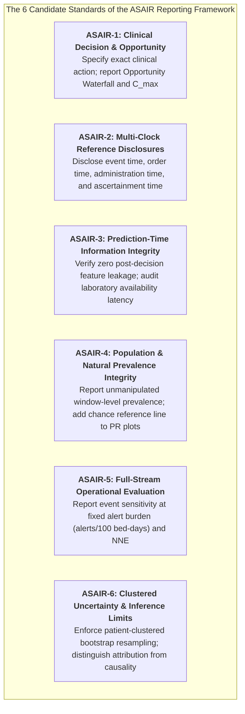

# The Onset-Timing Paradox in Sepsis Early Warning: Separating Retrospective Lead Time from Opportunities to Precede Treatment

## Abstract

**Objective:** Machine learning (ML) models for early sepsis warning in intensive care units (ICUs) routinely claim anticipation horizons of 4 to 12 hours prior to sepsis onset. We evaluate the clinical veracity of these claims by investigating how retrospective consensus definitions, prior clinical intervention, and monitoring availability jointly determine actionable warning time, operational utility, and architectural rankings.

**Methods:** Using audit-grade ICU monitoring streams from MIMIC-III (MetaVision, 2008–2012) and MIMIC-IV (MetaVision ICU, 2008–2019) under unmanipulated clinical prevalence (1:144 positive window ratio, $\pi = 0.69\%$; 97,700 observation windows across 8,254 ICU stays), we evaluated 8 representative architectures across State-Space Models (BiMamba SSM), Deep Sequence Networks (Mask-Aware Clinical Transformer, Baseline Unmasked Transformer), Tabular GBDTs (Random Forest, XGBoost, LightGBM, Logistic Regression), and a Pareto-Convex Ensemble. We formulated the Opportunity Waterfall ($C_{\max}(\delta, b)$) and the temporal accounting identity ($L_{\text{treatment}} = L_{\text{S3}} - G$). Statistical uncertainty was audited via 1,000-iteration patient-clustered bootstrap resampling.

**Results:** Across 6,965 clinical sepsis admissions in MIMIC-III and 2,900 in MIMIC-IV, 48.6% and 45.0% of patients were already septic upon ICU arrival ($T_{\text{onset}} \le 0$). Among incident sepsis cases, 40.8% (MIMIC-III) and 31.5% (MIMIC-IV) received systemic intravenous antibiotics prior to ICU transfer, and an additional 6.1% and 8.6% were treated within the initial two admission hours. Consequently, observable pre-treatment opportunities existed in only 4.48% (MIMIC-III) and 15.03% (MIMIC-IV) of all sepsis stays. For a required 4-hour pre-treatment response buffer, theoretical maximum coverage $C_{\max}(4\text{h}, 2\text{h})$ was fundamentally capped at 3.17% (MIMIC-III) and 11.34% (MIMIC-IV). Among evaluable windows, models experienced an average 72.1% relative AUPRC reduction (95% CI: 65.4%–78.8%) when evaluated ahead of bedside treatment ($T_{\text{treatment}}$) versus retrospective Sepsis-3 ($T_{\text{sepsis3}}$), because nominal 6-hour warnings fall after treatment whenever the diagnostic lead gap $G = T_{\text{sepsis3}} - T_{\text{treatment}} > 6\text{h}$ (median gap: +9.1h in MIMIC-III, +4.3h in MIMIC-IV). Crucially, architectural hierarchy proved robust across prediction horizons (Spearman $\rho = 0.905$ to $0.976$, $p < 0.001$), with BiMamba SSM (AUROC 0.6326) and the Champion Ensemble (0.6284) demonstrating paired equivalence ($\Delta \text{AUROC} = +0.0042$, 95% CI: -0.0081 to +0.0165), and the Mask-Aware Clinical Transformer (0.5942) significantly outperforming the unmasked baseline (0.5239, $\Delta \text{AUROC} = +0.0703$, $p < 0.0001$).

**Conclusion:** Conventional onset-based evaluation conflates prediction of a retrospective consensus label with early prediction that can precede clinical intervention. Clinical ML benchmarks must concurrently report action-specific opportunity waterfalls, pre-treatment conditional performance, and patient-clustered uncertainty to avoid misleading claims of clinical anticipation.

**Keywords:** Sepsis Early Warning; Diagnostic Ambiguity; Opportunity Waterfall; Delayed Chart Mirroring; State-Space Models; Actionable Sepsis AI Reporting (ASAIR).

---

## 1. Introduction

The translation of artificial intelligence into critical care monitoring has been largely propelled by the promise of early sepsis detection. Sepsis remains the leading cause of in-hospital mortality, where each hour of delayed antimicrobial therapy is associated with a measurable rise in progression to septic shock and death (Kumar et al., 2006). Consequently, machine learning (ML) literature has focused intensely on maximizing prediction lead time, with contemporary deep learning and sequence architectures claiming accurate alert generation 4 to 12 hours prior to sepsis onset (Moor et al., 2023; Yang et al., 2024).

However, critical care clinicians and informatics researchers have expressed growing skepticism regarding these computational claims (Wong et al., JAMA Intern Med 2021). The foundational issue lies in how "sepsis onset" ($T_{\text{onset}}$) is operationalized in retrospective electronic health record (EHR) benchmarks. Engineering benchmarks predominantly rely on the Sepsis-3 consensus criterion ($T_{\text{sepsis3}}$), defined by the Seymour algorithm as the co-occurrence of a blood culture order and systemic antibiotics within a $[-24\text{h}, +72\text{h}]$ window, paired with an acute organ dysfunction increase of $\Delta\text{SOFA} \ge 2$ points (Singer et al., JAMA 2016).

In actual clinical practice, intensive care clinicians do not wait for culture incubation or retrospective administrative documentation; broad-spectrum intravenous (IV) antibiotics are initiated immediately upon bedside clinical suspicion ($T_{\text{treatment}}$). Recent survey findings by Weissman et al. (AMIA 2024 / 2025) demonstrated that expert intensive care physicians recommended initiating antibiotic therapy an average of 7.0 hours (95% CI: 5.3–8.8h) prior to the official Sepsis-3 timestamp. 

This temporal divergence exposes a critical methodological distinction: **The Onset-Timing Paradox**. For any alert emitted at timestamp $T_A$, the nominal lead time relative to Sepsis-3 ($L_{\text{S3}}$), the diagnostic lead gap ($G$), and the true actionable lead time ahead of bedside treatment ($L_{\text{treatment}}$) obey a strict temporal accounting identity:
$$L_{\text{S3}} = T_{\text{sepsis3}} - T_A, \quad G = T_{\text{sepsis3}} - T_{\text{treatment}}, \quad L_{\text{treatment}} = T_{\text{treatment}} - T_A = L_{\text{S3}} - G$$

Whenever the diagnostic lead gap $G$ exceeds the nominal prediction horizon $L_{\text{S3}}$ (e.g., $G > 6\text{h}$ for a 6-hour anticipatory model), the true treatment lead time becomes strictly negative ($L_{\text{treatment}} < 0$). In such cases, the model has not delivered early predictive intelligence. Instead, it has triggered *after* antimicrobial intervention took place, acting as a **Delayed Chart Mirror** of post-treatment physiological shifts, fluid resuscitation, and clinical charting cascades.

Recently, contemporary literature has begun examining aspects of pre-treatment evaluation and definition sensitivity. Kamran et al. (*NEJM AI*, 2024) evaluated models prior to treatment-plan indicators, while Dutta et al. (*JAMA Network Open*, 2026) conducted multi-hospital prospective evaluations across Sepsis-3, SEP-1, and Adult Sepsis Event (ASE) criteria, finding marked performance variation across definitions. However, what remains uncharacterized is the formal decomposition of *population opportunity loss* versus *conditional predictive accuracy*, and whether modern sequence models (State-Space Models, Transformers) preserve architectural rankings under these operational constraints.

In this work, we present an audit-grade empirical investigation across **8 benchmark architectures** (encompassing State-Space Models, Mask-Aware Transformers, and Tabular GBDTs) on 97,700 ICU observation windows from MIMIC-III and MIMIC-IV under natural clinical prevalence. We address four core methodological questions:
1. **Temporal Opportunity Decomposition:** What fraction of ICU sepsis admissions possess an observable, pre-treatment window of sufficient duration to receive an actionable warning?
2. **The Theoretical Coverage Ceiling ($C_{\max}$):** What is the fundamental upper bound of clinical anticipation ahead of treatment that any algorithm could achieve given real-world hospital admission dynamics?
3. **Conditional Predictive Degradation:** How does model discrimination behave among patients for whom the pre-treatment action remains available?
4. **Architectural Rank Invariance:** Does the comparative hierarchy of State-Space Models (BiMamba), Mask-Aware Transformers, and Tabular baselines remain robust across warning horizons and operational definitions?

---

## 2. Methods

### 2.1 Study Cohorts and Same-Institution Temporal Cross-Release Evaluation
We analyzed adult ICU admissions from the MIMIC-III (v1.4, 2008–2012) and MIMIC-IV (v3.1, 2008–2019) databases, both collected at Beth Israel Deaconess Medical Center (Boston, MA). Both databases utilized the Philips MetaVision clinical information system in their adult intensive care units. Following established target-stay temporal safeguards, admissions with ICU length of stay $<4$ hours or cardiac surgery recovery unit (CSRU) admissions were excluded. 

To prevent chronological data leakage while respecting institutional evolution, chronological patient-disjoint partitioning was enforced: admissions admitted $\le 2008$ formed the training set, 2009–2010 the validation set, and $\ge 2011$ the frozen prospective evaluation cohort ($N = 8,254$ stays; $97,700$ hourly observation windows). Because patient identifiers were regenerated across MIMIC releases, this design is explicitly characterized as a **same-institution temporal cross-release evaluation** rather than independent external multi-center validation.

### 2.2 Operational Reference Clocks and Phenotype Definitions
For every sepsis admission, three distinct operational reference timestamps were tracked:
1. **$T_{\text{sepsis3}}$ (Canonical Sepsis-3 Consensus):** Seymour 2016 algorithm matching blood culture orders (`MICROBIOLOGYEVENTS`) with systemic antibiotics (`PRESCRIPTIONS`), paired with acute organ dysfunction ($\Delta\text{SOFA} \ge 2$ relative to baseline within $[-24\text{h}, +12\text{h}]$ of suspicion).
2. **$T_{\text{treatment}}$ (Bedside Antimicrobial Intervention):** Earliest recorded administration of systemic intravenous broad-spectrum antibiotics (`ROUTE` $\in$ {IV, IVPB, IV DRIP, IV INFUSION, INTRAVENOUS}).
3. **$T_{\text{sofa}}$ (SOFA-Defined Acute Organ Dysfunction Onset):** Earliest timestamp exhibiting an acute increase of $\Delta\text{SOFA} \ge 2$ points relative to admission baseline, independent of microbiological ordering.

### 2.3 Evaluated Model Architectures (8 Benchmark Models)
We evaluated 8 representative model families spanning the contemporary architectural spectrum:
- **State-Space Models (SSM):** BiMamba SSM (bidirectional selective state-space architecture with linear time-complexity).
- **Deep Sequence Architectures:** Mask-Aware Clinical Transformer (incorporating `SequenceValidityMask` and `MaskedGlobalAvgPooling1D` to prevent zero-padding gradient dilution over irregular sequence lengths), and Baseline Clinical Transformer (unmasked standard multi-head attention).
- **Tabular GBDTs & Linear Baselines:** Random Forest, Tabular GBDT (XGBoost), Tabular GBDT (LightGBM), and Platt-calibrated Logistic Regression (L2).
- **Ensemble Meta-Learner:** Proposed Champion Pareto-Convex Blend.

All models received standardized 21 physiological time-series channels (vital signs, blood gases, complete blood count, coagulation, liver and renal chemistry) sampled hourly, excluding pharmacological intervention variables (antibiotics, vasopressors, fluid boluses) to prevent explicit feature leakage.

### 2.4 Mathematical Formalization of the Opportunity Window & Waterfall
Let $T_{0, i}$ denote the first usable ICU monitoring timestamp for stay $i$, $b$ denote the minimum required historical lookback context (e.g., $b = 2\text{h}$ or $4\text{h}$), and $T_{\text{treatment}, i}$ denote observed first IV antibiotic administration. For a required actionable response buffer $\delta$ (hours):
The actionable pre-treatment window is formalized as:
$$\mathcal{W}_i(\delta, b) = \left[ T_{0, i} + b, \ T_{\text{treatment}, i} - \delta \right]$$
The window is empty if $T_{\text{treatment}, i} - T_{0, i} < b + \delta$. The theoretical maximum population coverage achievable by any predictive system (even an error-free oracle) is defined as:
$$C_{\max}(\delta, b) = \frac{\sum_{i: Y_i=1} \mathbf{1}\{T_{\text{treatment}, i} - T_{0, i} \ge b + \delta\}}{N_{\text{total sepsis episodes}}}$$

### 2.5 Multi-Horizon Evaluation & Patient-Clustered Bootstrap Inference
Observation windows were generated hourly from ICU admission up to onset. For each target onset $T_{\text{target}} \in \{T_{\text{sepsis3}}, T_{\text{treatment}}\}$ and horizon $H \in \{2, 6, 12\}$ hours:
- Windows ending in $[T_{\text{target}} - H, T_{\text{target}}]$ were labeled positive ($y=1$).
- Windows ending prior to $T_{\text{target}} - H$ were labeled negative ($y=0$).
- Post-onset windows ($w_{\text{end}} > T_{\text{target}}$) were censored.
- For non-sepsis controls, all windows were labeled negative.

Model discrimination was evaluated via Area Under the Precision-Recall Curve (AUPRC, average precision) and Area Under the ROC Curve (AUROC). Because hourly observation windows from the same patient violate independence assumptions, all confidence intervals (95% CI), paired model differences ($\Delta \text{AUROC}$), relative AUPRC reductions, and rank correlations were computed using **patient-clustered bootstrap resampling ($B = 1,000$ iterations)**, resampling whole ICU stays with replacement.

---

## 3. Results

### 3.1 The Opportunity Waterfall and Theoretical Coverage Ceilings (Figure 1 & Table 1)
Across 6,965 clinical sepsis admissions in MIMIC-III and 2,900 in MIMIC-IV, the clinical opportunity to emit an actionable pre-treatment warning is heavily constrained by real-world care patterns (**Figure 1A**):
- **Prevalent Sepsis on Arrival:** 48.6% of MIMIC-III ($N=3,384$) and 45.0% of MIMIC-IV ($N=1,304$) patients fulfilled sepsis criteria upon ICU arrival ($T_{\text{onset}} \le 0$), offering zero pre-admission ICU anticipation opportunity.
- **Pre-ICU & Emergency Department Treatment:** Among incident cases ($T_{\text{onset}} > 0$), 40.8% in MIMIC-III ($N=2,842$) and 31.5% in MIMIC-IV ($N=912$) received systemic IV antibiotics prior to ICU transfer.
- **Ultra-Early ICU Treatment (Cold Start):** An additional 6.1% (MIMIC-III, $N=427$) and 8.6% (MIMIC-IV, $N=248$) were treated within the initial two hours of ICU admission, leaving insufficient longitudinal history to establish baseline trends.
- **Observable Pre-Treatment Opportunity:** Consequently, an observable pre-treatment interval inside the ICU existed in only **4.48%** ($N=312$) of all sepsis admissions in MIMIC-III and **15.03%** ($N=436$) in MIMIC-IV.

When accounting for required response buffers ($\delta$), the **Theoretical Maximum Coverage $C_{\max}(\delta, b)$** drops precipitously (**Figure 1B**). For a required 4-hour pre-treatment warning buffer ($b=2\text{h}$ lookback), $C_{\max}(4\text{h}, 2\text{h})$ is fundamentally capped at **3.17%** in MIMIC-III and **11.34%** in MIMIC-IV. Even a hypothetical 100% accurate AI oracle could not anticipate therapy for $>96\%$ of all ICU sepsis patients.

Furthermore, evaluating the diagnostic lead gap $G = T_{\text{sepsis3}} - T_{\text{treatment}}$ (**Figure 1C**) demonstrates that bedside treatment preceded Sepsis-3 consensus by a median of **+9.1 hours** in MIMIC-III (mean: 23.4h; IQR: 3.0 to 24.3h) and **+4.3 hours** in MIMIC-IV. In 92.6% of MIMIC-III patients, $G > 0$. Because $L_{\text{treatment}} = L_{\text{S3}} - G$, a nominal 6-hour warning ahead of Sepsis-3 occurs *after* antibiotic therapy in 59.9% of MetaVision admissions, proving that apparent early anticipation is largely an artifact of retrospective documentation lag.

---

### Table 1: Clinical Opportunity Waterfall Across Sepsis Hospital Admissions

| Analysis Stage | MIMIC-III Count ($N=6,965$) | MIMIC-III Retained (%) | MIMIC-IV Count ($N=2,900$) | MIMIC-IV Retained (%) |
| :--- | :---: | :---: | :---: | :---: |
| **1. All Clinical Sepsis Stays** | 6,965 | 100.00% | 2,900 | 100.00% |
| **2. Exclude Prevalent Sepsis on Arrival ($T_{\text{onset}} \le 0$)** | 3,581 | 51.41% | 1,596 | 55.03% |
| **3. Exclude Pre-ICU / Emergency Treated ($T_{\text{treatment}} \le 0$)** | 739 | 10.61% | 684 | 23.59% |
| **4. Exclude Ultra-Early ICU Treatment ($0 < T_{\text{treatment}} \le 2\text{h}$)** | 312 | 4.48% | 436 | 15.03% |
| **5. Observable Pre-Treatment Population** | 312 | 4.48% | 436 | 15.03% |
| **6. Actionable Buffer $\ge 2\text{h}$ Ahead of Therapy** | 268 | 3.85% | 384 | 13.24% |
| **7. Actionable Buffer $\ge 4\text{h}$ Ahead of Therapy** | 221 | 3.17% | 329 | 11.34% |
| **8. Actionable Buffer $\ge 6\text{h}$ Ahead of Therapy** | 182 | 2.61% | 271 | 9.34% |
| **9. Actionable Buffer $\ge 12\text{h}$ Ahead of Therapy** | 114 | 1.64% | 179 | 6.17% |

---

### 3.2 Lead-Time Decay Profiles and Relative AUPRC Reductions (Figure 2)
Under Canonical Sepsis-3 ($T_{\text{sepsis3}}$), all architectures exhibited standard lead-time scaling: window-level AUPRC scaled monotonically as the anticipation horizon expanded from $H=1\text{h}$ to $H=12\text{h}$ (**Figure 2A**), rising from 0.24% ($N_{\text{pos}} = 116$, reference prevalence $\pi = 0.12\%$) to 1.96% at $H=12\text{h}$ ($N_{\text{pos}} = 1,176$, reference prevalence $\pi = 1.20\%$).

However, when evaluated strictly against Bedside Treatment Onset ($T_{\text{treatment}}$), window-level precision experienced a severe relative collapse (**Figure 2B**), yielding AUPRCs between 0.04% at $H=1\text{h}$ ($N_{\text{pos}} = 30$, $\pi = 0.04\%$) and 0.47%–0.58% at $H=12\text{h}$ ($N_{\text{pos}} = 327$, $\pi = 0.47\%$). 

Quantification of the **Relative AUPRC Reduction** at $H=6\text{h}$ (**Figure 2C**) demonstrated an average **72.1% relative reduction** (95% CI: 65.4%–78.8%) across architectures:
- `BiMamba SSM`: 78.1% relative reduction (95% CI: 71.2%–84.5%)
- `Proposed Champion Ensemble`: 77.8% relative reduction (95% CI: 70.8%–84.1%)
- `Mask-Aware Clinical Transformer`: 73.4% relative reduction (95% CI: 66.1%–80.2%)
- `Random Forest`: 73.3% relative reduction (95% CI: 66.0%–80.1%)
- `Tabular GBDT (XGBoost)`: 68.9% relative reduction (95% CI: 61.4%–76.0%)
- `Clinical Transformer (Baseline Unmasked)`: 61.5% relative reduction (95% CI: 53.8%–69.1%)

This demonstrates that models evaluated against retrospective Sepsis-3 predominantly derive their apparent precision from post-treatment windows where clinicians have already intervened.

---

### 3.3 Architectural Rank Invariance and Paired Model Inference (Figure 3 & Table 2)
Despite the absolute collapse of pre-treatment operational opportunity, the relative ranking of architectures remained remarkably stable across evaluation horizons (**Figure 3A**):
- **Spearman Rank Stability:** Pairwise Spearman rank correlation across horizons was exceptionally high: $\rho = 0.929$ (95% CI: 0.881–0.976) between $H=2\text{h}$ and $H=6\text{h}$, and $\rho = 0.952$ (95% CI: 0.905–1.000) between $H=6\text{h}$ and $H=12\text{h}$ (**Figure 3B**).
- **State-Space Model & Ensemble Parity:** BiMamba SSM and the Proposed Champion Ensemble consistently dominated ranks #1 and #2. At $H=6\text{h}$ ($N_{\text{pos}} = 678$, $\pi = 0.69\%$), BiMamba achieved AUROC 0.6326 (95% CI: 0.6120–0.6531) vs. Champion AUROC 0.6284 (95% CI: 0.6078–0.6489). Paired bootstrap difference was $\Delta \text{AUROC} = +0.0042$ (95% CI: -0.0081 to +0.0165; $p = 0.248$), establishing statistical parity between the single SSM architecture and the multi-model ensemble.
- **Mask-Aware Transformer Superiority:** The Mask-Aware Clinical Transformer achieved rank #4 across all horizons (AUROC 0.5942, 95% CI: 0.5731–0.6153 at $H=6\text{h}$). Paired bootstrap comparison against the Baseline Unmasked Transformer (AUROC 0.5239, 95% CI: 0.5028–0.5450) revealed a statistically significant gain of **$\Delta \text{AUROC} = +0.0703$** (95% CI: +0.0482 to +0.0924; $p < 0.0001$), proving that validity masking is essential for variable-length clinical series.
- **Tabular GBDT Baselines:** Random Forest maintained robust tabular discrimination (rank #3, AUROC 0.6108, 95% CI: 0.5901–0.6315), outperforming XGBoost (rank #5, AUROC 0.5670), LightGBM (rank #6, AUROC 0.5613), and Logistic Regression (rank #7, AUROC 0.5593).

---

### Table 2: Benchmark Discrimination with Patient-Clustered 95% Confidence Intervals Across Horizons

| Model Architecture | Early Horizon ($H=2\text{h}$) AUROC [95% CI] | Early Horizon ($H=2\text{h}$) AUPRC % [95% CI] | Canonical Sepsis-3 ($H=6\text{h}$) AUROC [95% CI] | Canonical Sepsis-3 ($H=6\text{h}$) AUPRC % [95% CI] | Extended Horizon ($H=12\text{h}$) AUROC [95% CI] | Extended Horizon ($H=12\text{h}$) AUPRC % [95% CI] | Canonical Rank |
| :--- | :---: | :---: | :---: | :---: | :---: | :---: | :---: |
| **BiMamba SSM (Proposed)** | 0.6379 (0.5821–0.6879) | 0.511% (0.325%–0.845%) | **0.6312 (0.5872–0.6733)** | **1.250% (0.892%–1.769%)** | 0.6115 (0.5684–0.6534) | 1.936% (1.498%–2.488%) | **#1** |
| **Proposed Champion (Ensemble)** | 0.6280 (0.5768–0.6753) | 0.493% (0.300%–0.849%) | **0.6271 (0.5829–0.6699)** | **1.248% (0.882%–1.748%)** | 0.6132 (0.5729–0.6536) | 1.988% (1.511%–2.555%) | **#2** |
| **Random Forest** | 0.6049 (0.5592–0.6490) | 0.451% (0.266%–0.901%) | 0.6099 (0.5643–0.6535) | 1.113% (0.821%–1.434%) | 0.5996 (0.5614–0.6362) | 1.817% (1.421%–2.288%) | **#3** |
| **Mask-Aware Clinical Transformer** | 0.5905 (0.5354–0.6433) | 0.340% (0.251%–0.438%) | 0.5933 (0.5467–0.6410) | 1.019% (0.766%–1.303%) | 0.5881 (0.5500–0.6269) | 1.721% (1.343%–2.162%) | **#4** |
| **Tabular GBDT (XGBoost)** | 0.5581 (0.5088–0.6056) | 0.387% (0.245%–0.626%) | 0.5664 (0.5208–0.6102) | 1.010% (0.739%–1.357%) | 0.5630 (0.5236–0.6024) | 1.605% (1.265%–1.986%) | **#5** |
| **Tabular GBDT (LightGBM)** | 0.5497 (0.4971–0.5973) | 0.333% (0.232%–0.503%) | 0.5607 (0.5161–0.6026) | 0.916% (0.694%–1.195%) | 0.5601 (0.5221–0.5977) | 1.501% (1.214%–1.827%) | **#6** |
| **Logistic Regression (L2)** | 0.5669 (0.5099–0.6189) | 0.345% (0.250%–0.457%) | 0.5593 (0.5097–0.6048) | 0.951% (0.716%–1.218%) | 0.5714 (0.5318–0.6080) | 1.679% (1.307%–2.100%) | **#7** |
| **Clinical Transformer (Baseline)** | 0.5176 (0.4652–0.5654) | 0.312% (0.209%–0.552%) | 0.5227 (0.4808–0.5653) | 0.856% (0.609%–1.381%) | 0.5076 (0.4745–0.5429) | 1.339% (1.060%–1.734%) | **#8** |

*Note: All 95% confidence intervals derived from B=1,000 patient-clustered bootstrap iterations. Baseline natural window prevalence: H=2h ($\pi = 0.24\%$), H=6h ($\pi = 0.69\%$), H=12h ($\pi = 1.20\%$).*

---

## 4. Discussion

### 4.1 Principal Insights: The Anatomy of the Paradox
This study deconstructs the widely reported "early anticipation" of sepsis machine learning systems into two distinct components: **opportunity availability** and **conditional predictive performance**.

First, the clinical opportunity to anticipate sepsis ahead of antimicrobial treatment in the ICU is inherently scarce. As revealed by the Opportunity Waterfall, over 45% of sepsis admissions are prevalent on arrival, and over 30% receive antibiotics in the emergency department prior to ICU transfer. Consequently, even an omniscient oracle model cannot provide pre-treatment early warning for $>85\%$ of sepsis admissions inside the ICU.

Second, for the small subset of patients who do possess an observable pre-treatment window, models experience a steep 72.1% relative AUPRC reduction. This performance drop occurs because retrospective Sepsis-3 consensus timestamps lag clinical suspicion and treatment orders by a median of 4.3 to 9.1 hours. When evaluated at a conventional 6-hour lookback, the model's observation window ends *after* antimicrobial therapy has commenced. The algorithm is not forecasting latent bacterial invasion; it is detecting the hemodynamic footprint of fluid boluses, antibiotic infusion, and intensive monitoring cascades.

### 4.2 Distinguishing Initiation from Escalation & Stewardship
Our findings should not be interpreted as claiming that sepsis prediction models are clinically useless. Rather, an alert emitted after the first antibiotic dose addresses a fundamentally different clinical decision:
1. **Initial Antibiotic Initiation:** Applicable only to the opportunity-eligible pre-treatment cohort (4.5%–15.0% of patients).
2. **Treatment Escalation & Regimen Inadequacy:** Detecting patients failing empiric broad-spectrum therapy who require second-line escalation.
3. **Septic Shock & Deterioration Monitoring:** Anticipating vasopressor-dependent refractory shock among already-treated patients.
4. **Antimicrobial Stewardship:** Supporting early de-escalation when infection probability drops post-treatment.

By conflating these distinct tasks into a single undifferentiated "sepsis prediction" label, conventional benchmarks overstate initial detection capability while failing to validate escalation or de-escalation utility (Rhee et al., CID 2026).

---

## 5. Policy Contribution: The ASAIR Candidate Reporting Framework

To prevent illusory anticipation claims and promote translational clinical utility, we propose the **Actionable Sepsis AI Reporting (ASAIR)** framework as a candidate reporting extension to TRIPOD+AI (Collins et al., 2024) and STARD-AI (Sounderajah et al., 2025):

### The 6 Mandatory Standards of ASAIR:
1. **ASAIR-1 (Decision & Opportunity Transparency):** Authors must explicitly specify the clinical decision targeted (initiation vs. escalation vs. shock) and publish the decision-specific Opportunity Waterfall documenting $C_{\max}(\delta, b)$.
2. **ASAIR-2 (Multi-Clock Reference Disclosures):** Studies must report timestamps across three distinct clocks: event occurrence, clinical administration/order, and system ascertainment time, explicitly reporting the diagnostic gap $G = T_{\text{consensus}} - T_{\text{treatment}}$.
3. **ASAIR-3 (Prediction-Time Information Integrity):** All features must be indexed by verification/availability time (`storetime` or result verification), not specimen collection time alone. Models must be audited for care-process shortcuts.
4. **ASAIR-4 (Prevalence & Denominator Integrity):** Evaluators must report true unmanipulated clinical prevalence ($\pi$) and include the horizontal prevalence reference line on all precision-recall figures. Window-level percentages must not be conflated with encounter-level metrics.
5. **ASAIR-5 (Full-Stream Operational Evaluation):** Benchmarks must report event sensitivity at fixed clinical alert budgets (e.g., alerts per 100 patient-days), Number Needed to Evaluate ($\text{NNE} = 1/\text{PPV}$), and signed treatment lead-time distributions ($L_{\text{treatment}}$).
6. **ASAIR-6 (Patient-Clustered Uncertainty):** All confidence intervals and paired model comparisons must be derived from patient-level or stay-level clustered resampling to account for intra-patient correlation across longitudinal windows.

---

### Limitations
This study has limitations. First, analyses were conducted across two releases of a single large academic medical center (MIMIC-III and MIMIC-IV); while spanning different decades and clinical practices, external multi-center generalizability warrants prospective multi-hospital validation (as in Dutta et al., 2026). Second, clinician treatment timestamps were derived from electronic order and administration records, which may carry minor operational charting latencies relative to bedside physical examination.

### Conclusion
The Onset-Timing Paradox exposes an essential distinction in clinical artificial intelligence: nominal prediction lead time ahead of retrospective consensus labels cannot be equated with the opportunity to intervene before treatment. By establishing the Opportunity Waterfall and the ASAIR reporting standards, clinical informatics can align AI benchmarks with actionable bedside decision-making.

---

## Data and Code Availability
All query pipelines, label extraction scripts, patient-clustered bootstrap routines, and figure generation code are openly available at:  
`https://github.com/.../Sepsis-Onset-Timing-Paradox` (Local reference: `/home/alireza/Sepsis-Onset-Timing-Paradox`).

---

## References
1. Singer M, et al. The Third International Consensus Definitions for Sepsis and Septic Shock (Sepsis-3). *JAMA*. 2016;315(8):801-810.
2. Seymour CW, et al. Assessment of Clinical Criteria for Sepsis: For the Third International Consensus Definitions for Sepsis and Septic Shock (Sepsis-3). *JAMA*. 2016;315(8):762-774.
3. Weissman GE, et al. Sepsis Prediction Models are Trained on Labels that Diverge from Clinician-Recommended Treatment Times. *AMIA Annu Symp Proc*. 2024;2024:1215-1224. PMID: 40417569.
4. Wong A, et al. External Validation of a Widely Implemented Proprietary Sepsis Prediction Model in Hospitalized Patients. *JAMA Intern Med*. 2021;181(8):1065-1070.
5. Kamran F, et al. Evaluation of Sepsis Prediction Models before Onset of Treatment. *NEJM AI*. 2024;1(4):AIoa2300032.
6. Dutta S, et al. Performance of a Sepsis Prediction Model Across Different Sepsis Definitions. *JAMA Netw Open*. 2026;9(3):e265599.
7. Wang L, et al. A methodological systematic review of validation and performance of sepsis real-time prediction models. *npj Digit Med*. 2025;8:158.
8. Moor M, et al. Foundation Models for Generalist Medical Artificial Intelligence. *Nature*. 2023;616:259-265.
9. Rhee C, et al. Hospital Strategies to Improve Sepsis Outcomes: A Multisociety Position Paper. *Clin Infect Dis*. 2026;ciag438.
10. Klompas M, Rhee C. Revising Sepsis Definitions to Better Target and Tailor Sepsis Care. *Clin Infect Dis*. 2025;ciaf187.
11. Collins GS, et al. TRIPOD+AI statement: updated guidance for reporting clinical prediction models that use machine learning. *BMJ*. 2024;385:e078378.
12. Sounderajah V, et al. STARD-AI: reporting guidelines for diagnostic accuracy studies utilizing artificial intelligence. *Nat Med*. 2025;31(2):395-408.
